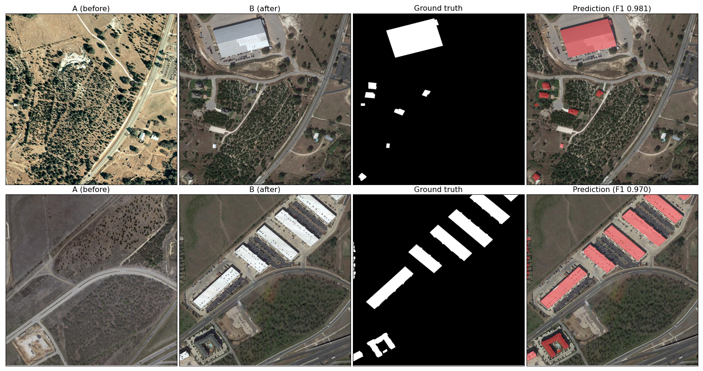
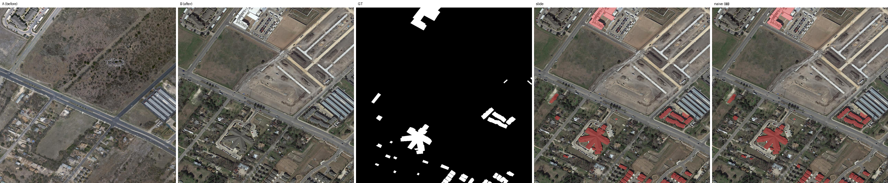
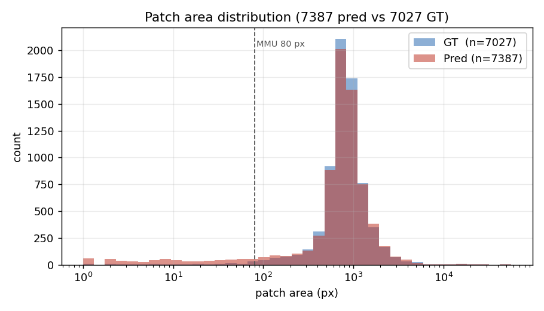

# LEVIR-CD 变化检测：从像素到图斑的完整交付链路



在 LEVIR-CD（637 对 1024×1024 双时相影像）上构建孪生双流变化检测模型，
**test F1 0.9027 / IoU 0.8227**，并打通「像素 → 图斑 → 矢量 → 部署」的完整链路：
图斑级 Precision 0.9113（MMU=80）、Boundary IoU 0.6340、轻量版 15.47 M / ONNX FP16 3.24 ms·张。

---

## 一、结果一览

**像素级**（test 2048 个 256×256 裁片，阈值 0.5，3 seed）

| 指标 | 值 | 说明 |
|---|---|---|
| **F1** | **0.9027**（3 seed: 0.9022 ± 0.0008） | 只统计变化类，背景不计入 |
| IoU | 0.8227 | 变化类 IoU，非 mIoU |
| Precision / Recall | 0.9132 / 0.8925 | 偏误检；Recall 略低 |
| OA | 0.9901 | 仅作参考（全 0 预测也有 0.949） |
| **空块误报** | **0.61‰** | 无变化影像上的误报像素占比 |

**图斑级**（整幅 1024² 拼图，8 邻域连通域，贪心一对一匹配）

| 指标 | 值 | 通过线 |
|---|---|---|
| 图斑级 Precision（MMU=80，即 20 m²） | **0.9113** | ≥0.80 |
| 图斑级 Recall | 0.8840 | — |
| Boundary IoU（带 r=2 px） | **0.6340** | ≥0.60 |
| 图斑数 | 预测 7 139 / 真值 7 027 | — |

**部署**

| 模型 | 参数 | 文件 | F1 | bs1 时延 | bs16 吞吐 |
|---|---|---|---|---|---|
| M1（主打） | 25.58 M | 97 MB | 0.9027 | 10.79 ms | 4.95 ms/张 |
| **L1 + ONNX FP16** | **15.47 M** | **31 MB** | 0.8977 | **4.75 ms** | **3.24 ms/张** |

> 口径说明：所有数字来自同一份 `test` 划分、同一评估脚本（`val.py`）、同一阈值。
> F1/IoU 只算变化类；换个集合或换个脚本得到的数字不与本表可比。

---

## 二、方法：一条单变量阶梯

| 代号 | 结构 | 参数 | test F1 | 只改了哪一件事 |
|---|---|---|---|---|
| B0 | 从零训练 U-Net（6 通道早融合） | 7.85 M | 0.8778 | 参照物 |
| B1 | ResNet34-UNet + ImageNet 预训练 | 24.53 M | 0.8791 | 编码器容量与预训练 |
| M0 | 孪生双流 ResNet34 + 逐层 concat | 25.23 M | **0.9031** | 融合方式（早融合 → 双流） |
| **M1** | M0 + 逐层特征差分 `\|f_A − f_B\|` | 25.58 M | **0.9027** | 加入显式差分项 |
| L1 | M1 的 ResNet18 窄化版 | 15.47 M | 0.8977 | 编码器换小 |
| C1 | BIT（Transformer，官方权重） | 11.94 M | 0.8880 | 结构对照 |

任何相邻两档**只差一个变量**，所以每一格差值都能归因。

---

## 三、四条结论（含两条负结论）

**1. 增益几乎全部来自「双流结构」，不是差分项。**
`B1 → M0` 提升 **+2.40 点**，而 `M0 → M1` 只有 −0.04 点（在 3 seed 噪声 ±0.08 之内）。
差分项本身没有净收益——这一点靠 M0 消融才能说清，没有 M0 就无法归因。

**2. 预训练买的是速度，不是上限。**
B1 达到 0.86 只需 14 epoch（B0 需 20），但末 5 轮平台完全相同（0.8704 vs 0.8704）。
在 445 对训练图 + 30 epoch 的设置下，ImageNet 先验的边际价值趋近于 0。

**3. 误报里 77.7% 是边界溢出，真正「无中生有」只有 2.8%。**
把全部 FP（549 406 px）按「离真值多远」拆开：贴边 ≤5 px 占 77.7%；
独立误检中 19.5% 是「影像确实变了但标注不覆盖」（厂房拆除、储罐翻新），
伪变化仅 2.8%。**因此本项目不做伪变化抑制模块**——这也解释了差分项为何在空块误报上与 M0 打平。

**4. 边界误差是双向抖动，不是系统性内缩。**
图册上目视像「预测块比真值小一圈」，但 6 157 对匹配的面积比中位数是 **1.004**（48% 内缩 / 52% 外扩）。
所以不能用膨胀后处理去修——那会把本来已经外扩的 52% 推得更糟。

---

## 四、业务线：像素之后还有一半

像素 F1 高不代表能入库。国土变更调查按**图斑**结算，一块建筑被切成 3 片就是 3 条记录。

**图斑化**：从 256 裁片拼回 1024² 再做连通域（不在裁片上做，否则跨界的图斑会被切碎）。
真值自检 7 027 个图斑 / 中位面积 805 px，与数据先验完全一致。

**碎斑过滤**（8 档对照，这是最能说明「不是靠删小图斑刷指标」的一张表）：

| 档位 | 图斑数 | 图斑级 P | 像素 F1 | 删掉的真是垃圾吗 |
|---|---|---|---|---|
| 不过滤 | 7 139 | 0.8624 | 0.9075 | — |
| **MMU=80** | **6 727（−5.8%）** | **0.9118（+4.9 点）** | **0.9076（+0.0001）** | 删掉像素中 57% 是误报 |
| 开运算 r=1 | 7 006 | 0.8797 | 0.9075 | 与 MMU 串联后**零增量** |
| 闭运算 r=1 | 7 458 | 0.8095 | 0.9074 | 有害，直接排除 |

被删的 412 个碎斑中，62.6% 纯误报、32.8% 是 <20 m² 的真实小变化（按国土口径本就不单独上图）。

**滑窗大图推理**：256 窗口 / 步长 128 / Hann 加权融合。

| | F1（整幅池化） | 接缝比 |
|---|---|---|
| 无重叠直拼 | 0.9027 | **13.30** |
| **重叠滑窗** | **0.9075** | **0.92** |

接缝比 = 接缝处二阶差分 / 内部二阶差分，理想值 1.0。**滑窗的收益在图斑层面（P +1.34 点）是像素层面（F1 +0.48 点）的 2.8 倍**——融合修掉的接缝断裂在像素上占比极小，在斑块计数上却直接变成「多出来的碎片」。





---

## 五、部署

ONNX 导出 + FP16 量化，**零掉点**（F1 差 ≤0.0001）。

| 模型 | 格式 | F1 | bs1 | bs16 |
|---|---|---|---|---|
| M1 | PyTorch FP32 | 0.9027 | 10.79 ms | 4.95 ms/张 |
| M1 | ONNX FP32 | 0.9028 | 7.00 ms | 5.25 ms/张 |
| M1 | ONNX FP16 | 0.9027 | 6.17 ms | 3.84 ms/张 |
| L1 | ONNX FP16 | 0.8977 | **4.75 ms** | **3.24 ms/张** |

**两个反直觉的实测结论**：

1. **ONNX FP32 的加速只在 batch=1 时成立**（1.5×）。batch=16 时 ONNX 反而比 PyTorch 慢
   （5.25 vs 4.95），因为 PyTorch 的批量并行已充分。**报时延必须写清 batch。**
2. 真正稳定的收益来自 **FP16**：两模型都是零掉点，bs16 吞吐再快 20–27%。

组合效果：单张 2.27×、批量 1.53×、文件 −68%，代价是 F1 −0.5 点。

> 未做：TensorRT INT8（本机缺 `libnvinfer` 原生库）。

---

## 六、快速开始

```bash
# 0) 环境：Python 3.10+ / PyTorch 2.x + CUDA，8 GB 显存可跑
pip install -r requirements.txt

# 1) 数据：LEVIR-CD 原始 1024² → 256 不重叠裁片（约 3 GB）
#    --out 默认是 <root>/crops，这里显式指到本项目根目录
python data/make_crops.py --root /path/to/LEVIR-CD --out crops --splits train val test

# 2) 训练（30 epoch，约 80 分钟 / RTX 4060 Laptop）
python train.py --model M1 --epochs 30 --batch-size 24

# 3) 评测（test 2048 裁片，输出 F1/IoU/P/R/OA/空块误报）
#    产物目录形如 run/train/M1_exp1/；若带 seed 参数会变成 M1_exp1_seed42
python val.py --ckpt run/train/M1_exp1/weights/best_model.pth --split test

# 4) 图斑级指标 + 碎斑过滤（先把滑窗掩膜跑出来）
python tools/sliding_window.py --ckpt run/train/M1_exp1/weights/best_model.pth --split test
python tools/patches.py --ckpt run/train/M1_exp1/weights/best_model.pth --split test
python tools/postprocess_filter.py --pred-dir run/slide/test_M1_exp1_thr0.5/mask --suffix _slide

# 5) 导出 ONNX + 精度复核
python tools/export_onnx.py --ckpt run/train/M1_exp1/weights/best_model.pth
python tools/onnx_eval.py --dir run/deploy/M1_exp1_best_model --split test --norm imagenet
```

**模型代号直接用**：`--model B0` / `B1` / `M0` / `M1` / `L1`，注册表按代号加载，不需要写路径。

---

## 七、仓库结构

```
model/            模型注册表 + ResNet18/34 编码器 + 差分融合
B0_…/ B1_…/ M0_…/ M1_…/ L1_…/   每档一个文件夹，放这一档的模型实现与说明
train.py val.py predict.py       训练 / 评测 / 可视化
data/             LEVIR 切分与数据先验统计
utils/            Dataset、损失、指标、日志
tools/            patches.py       图斑化 + 矢量导出
                  patch_metrics.py 图斑级 P/R + Boundary IoU
                  postprocess_filter.py  碎斑过滤 before/after
                  error_atlas.py   四类错误图册
                  sliding_window.py      滑窗大图推理
                  export_onnx.py / onnx_eval.py  导出与部署基准
                  fetch_bit_official.py          拉取 BIT 官方实现（C1 用，见 NOTICE）
docs/             每项交付物的方法文档（见下）
EXPERIMENTS.md    实验登记表：每条含假设 / 结果 / 结论
```

## 八、文档索引

| 文档 | 内容 |
|---|---|
| `docs/model_v1.md` | 模型三档的结构、口径与实测 |
| `docs/data_prior.md` | 数据先验：正样本占比、图斑面积分布、空块比例 |
| `docs/audit_report.md` | 数据审计（C1–C7 七项检查） |
| `docs/patch_postprocess.md` | 图斑化、图斑级指标、碎斑过滤口径 |
| `docs/error_atlas.md` | 四类错误归因与影像证据 |
| `docs/bit_control.md` | BIT 对照：BN 统计失准的诊断与修复 |
| `docs/deploy.md` | ONNX 三档、量化边界、四个坑 |
| `EXPERIMENTS.md` | 全部实验记录，含失败实验 |

## 九、局限

1. **无地理参考**：LEVIR 是 PNG，没有 CRS。矢量坐标是像素（可按 0.5 m/px 换米），不是经纬度。要真入库需配准后的 GeoTIFF。
2. **只做了 1 个结构对照**：BIT 的官方权重在 BN 校准后达 0.8880，未用本项目数据重训（官方划分与本项目 445/64/128 不一致）。
3. **L1 只有单 seed**；M1 有 3 seed，其余档位单 seed。
4. **M0 用了 batch=16，M1 用了 batch=24**，是唯一残留的协议差异。但 M0 在更小 batch 下仍与 M1 打平，负结论不受影响。
5. **未做伪变化抑制**：LEVIR 两期相隔 5–14 年，伪变化仅占 FP 的 2.8%，该数据集测不出差异；要验证需换同区域跨季节影像。

---

## 数据与权重

本仓库**不含** `crops/`（2.93 GB）、`weights/`、`run/`（训练产物），这些都在 `.gitignore` 里。
数据由 `data/make_crops.py` 从公开的 LEVIR-CD 生成，`crops/manifest.csv` 已入库，可用于核对切分是否一致。

## 许可与第三方代码

本项目原创代码与文档采用 **MIT**（见 [`LICENSE`](LICENSE)）。第三方资源见 [`NOTICE.md`](NOTICE.md)，三点值得注意：

1. **BIT 官方实现不随仓库分发**。上游 `justchenhao/BIT_CD` 未声明许可证，重新分发其源码不合规，
   因此改为运行时拉取：`python tools/fetch_bit_official.py`，落到 `BIT_LEVIR/official/`（已 gitignore）。
   本项目**未修改**其任何文件，只在外层注入 `torchvision.models.utils` 兼容 shim。
2. **ImageNet 预训练权重与 LEVIR-CD 数据集均不重新分发**，仅由脚本下载或由使用者自行获取。
3. `crops/manifest.csv` 只含文件名与统计量，不含影像内容。
